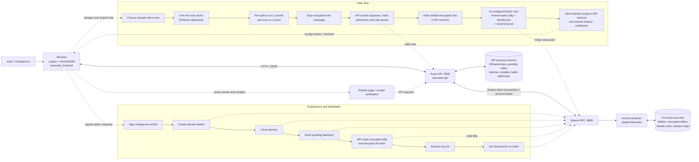

# Kaonashi Architecture

Kaonashi is a browser-based encrypted voting application built from a Rust/WASM
frontend, a Rust/Axum API, and an Anchor program on Solana. The diagram shows
the normal batched-voting flow, together with the separate chairperson and
results paths.

## Component responsibilities

- **Frontend (`kaonashi_frontend`)**: Leptos pages and browser-side crypto. The
  voter selects a movie, encrypts the one-hot vector with the decade's ElGamal
  public key, generates vote proofs, signs the submission, and posts it to the
  API. It also provides the chairperson workflow and results views.
- **API (`kaonashi-api`)**: Axum routes, request/signature/proof validation,
  temporary election coordination, batching, receipts, and Solana RPC
  operations. It keeps pending votes, generated ElGamal keypairs, receipts, and
  ballot addresses in process memory; restarting the API loses that state.
- **Smart contract (`kaonashi-smart-contract`)**: Anchor ballot and voter
  accounts, election state transitions, encrypted tally updates, and on-chain
  proof verification for submitted rollup batches.
- **Solana local validator / cluster**: Stores the program and ballot state and
  executes the instructions submitted by the API.

The current frontend/API batched path differs from the program's direct
`cast_vote` instruction: the frontend submits encrypted votes to the API, which
validates them and aggregates them off-chain before submitting a rollup batch.
The Groth16 batch circuit proves that the private leaf hashes form the supplied
Merkle root; the current circuit does not prove that the encrypted batch tally
was computed from those leaves.

## Local development endpoints

The API binds to `127.0.0.1:3000`
the Solana client uses local RPC at `127.0.0.1:8899`. 
Frontend assets are built and served with Trunk. 
The frontend API URL is currently hardcoded to `http://127.0.0.1:3000`.
